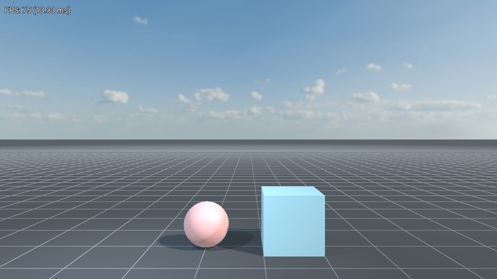

# codefury


### A C++ game engine for PlayStation 3 and Linux.

codefury is a C++ game engine targeting PlayStation 3 (GCM) and Linux (x86_64, OpenGL). codefury provides an entity-component architecture, Filamented PBR, and Wren scripting. Rendering is provided by [gcmgl](https://github.com/Index-Software/gcmgl), mathematics by [mathsfury](https://github.com/Index-Software/mathsfury), and scripting by [wren](https://github.com/wren-lang/wren) with [wrenbind](https://github.com/Index-Software/wrenbind).

## Requirements

##### Core dependencies:

- [gcmgl](https://github.com/Index-Software/gcmgl)
- [mathsfury](https://github.com/Index-Software/mathsfury)
- [wren](https://github.com/wren-lang/wren)
- [wrenbind](https://github.com/Index-Software/wrenbind)

##### PS3 build dependencies:

- [ps3toolchain](http://github.com/ps3dev/ps3toolchain)
- [PSL1GHT](http://github.com/ps3dev/PSL1GHT)
- [NVIDIA Cg Toolkit](https://developer.nvidia.com/cg-toolkit-download)
- [ImageMagick](https://imagemagick.org)

##### Linux build dependencies:

- [glad](https://github.com/Dav1dde/glad)
- [SIMDe](https://github.com/simd-everywhere/simde) (optional, for SSE path)
- [Slang](https://github.com/shader-slang/slang)

## Features

- OpenGL 3.2 (Linux, x86_64), GCM (PlayStation 3) support
- [Slang](https://github.com/shader-slang/slang) and Cg shaders
- [Filamented](https://gitlab.com/s-ilent/filamented) PBR
- Directional and point-light shadows
- Entity-component architecture
- Scene system with lights, cameras, materials, meshes
- Cubemap and equirectangular skybox support
- UI
- [MSDF](https://github.com/Chlumsky/msdf-atlas-gen) text rendering
- [Wren](https://github.com/wren-lang/wren) scripting
- Audio playback

## Usage

Template:

```cpp
#include "app/App.h"
#include "window/Window.h"
#include "utils/UtlMemory.h"
#include <new>

class CTemplateApp : public CApp
{
public:
	void GetWindowConfig(WindowConfig_t& windowConfig)
	{
		windowConfig.m_Width = 1600;
		windowConfig.m_Height = 900;
		windowConfig.m_Title = "Template";
	}

	bool Init(IRenderer*, const WindowConfig_t&)
	{
		return true;
	}

	bool Update(IRenderer*, float32)
	{
		return true;
	}
};

CApp* CreateApp()
{
	void* pAppMemory = CUtlMemory::Alloc(sizeof(CTemplateApp));
	if (pAppMemory)
	{
		return new(pAppMemory) CTemplateApp();
	}

	return CF_NULL;
}

void DestroyApp(CApp* pApp)
{
	if (pApp)
	{
		pApp->~CApp();
		CUtlMemory::Free(pApp);
	}
}
```

Demo:

```wren
import "engine/renderer/shader" for CShader
import "engine/renderer/material" for CMaterial
import "engine/ecs/entity_registry" for CEntityRegistry
import "engine/ecs/components/camera" for CCamera
import "engine/ecs/components/mesh_builder" for CMeshBuilder, FaceOrientation_t
import "engine/ecs/components/light" for CLight, LightType_t
import "engine/scene" for CScene
import "engine/renderer/renderer" for IRenderer
import "engine/color" for CColor
import "engine/maths/vector3" for CVector3

class App {
  init() {
    var litShader = CShader.new()
    litShader.createFromSource("lighting/Lit")

    var floorMaterial = CMaterial.new()
    floorMaterial.setShader(litShader)
    floorMaterial.setFloat("Smoothness", 0.9)
    floorMaterial.setFloat("Metallic", 0.0)

    // Floor
    var floorEntity = CEntityRegistry.createEntity(
      "Floor",
      CVector3.new(0.0, -1.0, 0.0))
    var floorMesh = CMeshBuilder.createPlane(
      floorMaterial,
      25.0,
      CColor.new(1.0, 1.0, 1.0, 1.0),
      FaceOrientation_t.Outwards,
      1)
    CEntityRegistry.addComponent(floorEntity, floorMesh)
    CScene.addEntity(floorEntity)

    var defaultMaterial = CMaterial.new()
    defaultMaterial.setShader(litShader)
    defaultMaterial.setFloat("Smoothness", 0.5)
    defaultMaterial.setFloat("Metallic", 0.0)

    // Sphere
    var sphereEntity = CEntityRegistry.createEntity(
      "Sphere",
      CVector3.new(0.0, 0.0, 0.0))
    var sphereMesh = CMeshBuilder.createSphere(
      defaultMaterial,
      0.8,
      16,
      32,
      CColor.new(1.0, 0.1, 0.1, 1.0),
      FaceOrientation_t.Outwards)
    CEntityRegistry.addComponent(sphereEntity, sphereMesh)
    CScene.addEntity(sphereEntity)

    // Cube
    var cubeEntity = CEntityRegistry.createEntity(
      "Cube",
      CVector3.new(3.0, 0.0, 0.0))
    var cubeMesh = CMeshBuilder.createCube(
      defaultMaterial,
      1.0,
      CColor.new(0.1, 0.8, 0.1, 1.0),
      FaceOrientation_t.Outwards,
      1)
    CEntityRegistry.addComponent(cubeEntity, cubeMesh)
    CScene.addEntity(cubeEntity)

    // Directional light
    var directionalLightEntity = CEntityRegistry.createEntity(
      "DirectionalLight")
    var directionalLight = CLight.new()
    directionalLight.setType(LightType_t.Directional)
    directionalLight.setDirection(CVector3.new(-1.0, -1.0, -1.0))
    CEntityRegistry.addComponent(directionalLightEntity, directionalLight)
    CScene.addEntity(directionalLightEntity)

    // Point light
    var pointLightEntity = CEntityRegistry.createEntity(
      "PointLight",
      CVector3.new(2.0, 3.0, 2.0))
    var pointLight = CLight.new()
    pointLight.setColor(CColor.new(1.0, 0.0, 0.0, 1.0))
    CEntityRegistry.addComponent(pointLightEntity, pointLight)
    CScene.addEntity(pointLightEntity)

    // Camera
    var cameraEntity = CEntityRegistry.createEntity(
      "Camera",
      CVector3.new(0.0, 2.0, 6.0),
      CVector3.new(0.0, -90.0, 0.0))
    var camera = CCamera.new()
    camera.setPerspective(45.0, IRenderer.getAspectRatio(), 0.1, 2000.0)
    CEntityRegistry.addComponent(cameraEntity, camera)
  }

  update(dt) {
    CScene.render()
  }
}
```

## Build

Install required build dependencies:

- Fedora:
```bash
sudo dnf install cmake gcc-c++ glfw-devel mesa-libGL-devel pkgconf-pkg-config ImageMagick
```

Build using the provided scripts:

- Linux (x86_64):
```bash
./tools/build_linux_x86_64.sh
```
- PlayStation 3:
```bash
./tools/build_ps3.sh
```

## Examples

Build scripts prompt for an example to build: `Template` or `Demo`.

- Template

- Demo


## License
codefury is licensed under the [MIT License](LICENSE).